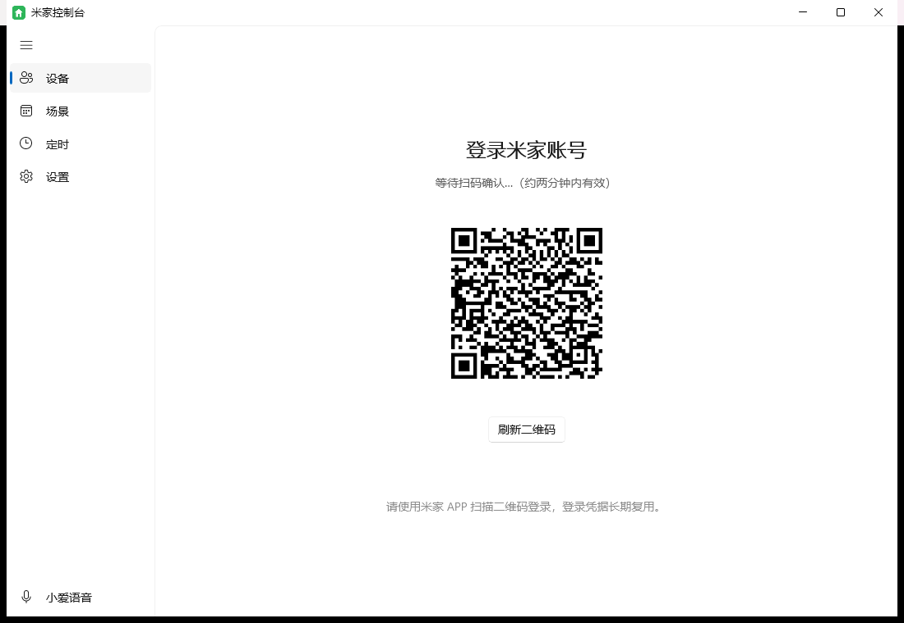

# MiHome-Windows-WinUI3

米家设备的 Windows 桌面控制端 —— [MiHome-Windows](https://github.com/huanyuejue/MiHome-Windows)（Python/PySide6）的 **WinUI 3 (C#/.NET 8) 纯原生重构版**。

不依赖 Python：原项目使用的 `mijiaAPI` Python 库（扫码登录、设备控制协议）已用 C# 完整重新实现。



## 功能

- **扫码登录**：米家 APP 扫二维码登录；凭据保存在 `~/.config/mijia-api/auth.json`，与上游 CLI 互通
- **设备列表**：按家庭/房间分组，在线状态、温湿度副标题（5 秒轮询）
- **设备控制**：按 spec 元数据自动生成控件——布尔属性→开关、数值→滑块（自动套范围步长）、枚举→下拉框；动作渲染为按钮（执行前二次确认）
- **开关快速控制**：spec 批量读开关状态，卡片直接切换；多键面板虚拟子设备（`<父did>.sN`）自动路由到父设备对应 siid
- **场景执行**：米家 APP 手动场景一键执行
- **定时开关**：每天某时刻开/关设备；只认正点那一分钟、不补执行只提醒（与原版语义一致）
- **系统托盘**：左键唤出主界面，右键快捷菜单（设备开关/退出）；关闭窗口最小化到托盘
- **小爱语音**：文本指令发送给在线小爱音箱（execute-text-directive）
- **设备图标**：productconfig/get_icon 接口获取 CDN 图标（302 Location）
- **主题配色**：浅色/深色/跟随系统 + 主题色选择
- **开机自启动**：HKCU Run 注册表
- **版本检测**：GitHub Releases 检查

## 安装

从 [Releases](https://github.com/xiao-jie520/MiHome-winui3/releases/latest) 下载 `MiHome-Setup-<版本>.msi` 双击安装即可：

- **每用户安装**到 `%LOCALAPPDATA%\Programs\MiHome`，**无需管理员权限**，不弹 UAC
- 自动创建开始菜单与桌面快捷方式，卸载从「设置 → 应用」或开始菜单右键完成
- 再次安装新版本会自动覆盖升级（MajorUpgrade）

## 构建

要求 Windows 10 1809+ 与 .NET 8 SDK。

### 只构建程序

```powershell
dotnet build src/MiHome.App/MiHome.App.csproj -p:Platform=x64 -c Release
# 输出：src/MiHome.App/bin/x64/Release/net8.0-windows10.0.19041.0/win-x64/MiHome.exe
```

### 打包 MSI 安装程序

```powershell
pwsh ./build-installer.ps1            # 默认 1.0.0
pwsh ./build-installer.ps1 -Version 1.0.1
# 输出：artifacts/MiHome-Setup-<版本>.msi
```

脚本自动完成：`dotnet publish` 自包含发布 → 安装 WiX 5（dotnet tool，免 Visual Studio）→ 生成 MSI。
CI（`.github/workflows/build.yml`）在每次推送构建 MSI 并留存产物，打 `v*` tag 时自动发布 Release 附件。

## 项目结构

```
src/
  MiHome.Core/              # 核心类库（net8.0，无 UI 依赖）
    Crypto/MiCrypto.cs      #   RC4 + 签名（移植自 mijiaAPI miutils.py）
    Api/MijiaApiClient.cs   #   米家云 API 客户端（登录/设备/场景/属性/动作/耗材）
    Spec/SpecService.cs     #   miot-spec.org 规格拉取与文件缓存
    Spec/SpecZh.cs          #   属性/动作名中文兜底表
    MiHomeService.cs        #   业务适配层（对应原 service.py）
    Stores/Stores.cs        #   settings.json / schedules.json + 调度引擎 + 更新检查 + 自启动
  MiHome.App/               # WinUI 3 前端
    MainWindow.xaml         #   NavigationView 导航 + 通知栏
    Views/                  #   登录页 / 设备页 / 场景页 / 定时页 / 设置页 / 各对话框
    Services/               #   托盘（Win32 Shell_NotifyIcon）与应用状态
```

## 与原项目的差异

- UI 框架：PySide6/SIUI → WinUI 3（Fluent Design 原生控件）
- 任务模型：Python 串行任务队列（JobExecutor）→ C# async/await
- 暂未实现：桌面挂件（widgets board）、托盘音响音量栏、界面无级缩放（可按 Fluent 默认缩放）
- 认证文件与 CLI 互通，本地数据目录沿用 `%LOCALAPPDATA%\MiHome-Windows\`

## 更新日志

### v1.0.2（修复扫码登录与设备页）
- **修复扫码后仍显示未登录**：`serviceToken` cookie 落在 `.sts.api.mijia.tech` 域，原实现按域名从 CookieContainer 取导致漏掉；改为解析 `Set-Cookie` 响应头并按上游格式手工拼 `Cookie` 头
- **修复响应解析**：服务端返回 gzip 明文/RC4 密文两种形态，按字节判定后解密/解压
- **修复设备属性名**：spec URN 短名取第 4 段（原取最后一段得到版本号），开关识别、中文名、控件的范围全部恢复
- 登录态改为本地判断 + 服务端 auth error 自动刷新 token 重试，避免死锁与误判
- 升级 Windows App SDK 1.6 → **1.7**：修复在 Windows 11 26100 上的偶发原生堆损坏崩溃
- 托盘改用 H.NotifyIcon 封装；`Shell_NotifyIcon` 不再阻塞 UI 线程
- 设备卡片：点开关不再误弹详情；卡片左对齐
- 新增「自动刷新设备状态（5 秒）」设置项（默认开启）
